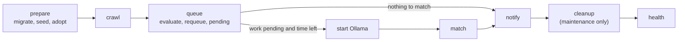

# GitHub workflows

What each workflow in `.github/workflows` is for, when it runs, what it does step by step and what a failure means. For day-to-day operation (manual inputs, repository variables, the runbook) see [OPERATIONS.md](OPERATIONS.md). For minutes and money see [COSTS.md](COSTS.md).

## Overview

The workflows fall into three groups.

| Workflow | Group | Runs on | Secrets | Timeout |
| --- | --- | --- | --- | --- |
| [`discovery`](#discovery) | Production | Daily cron, backup cron, manual | Yes | 60 min |
| [`maintenance`](#maintenance) | Production | Daily cron, backup cron, manual | Yes (not the drill) | 30 min, drill 10 min |
| [`ci`](#ci) | Checks | Every push to `master`, every pull request | No | 5 to 10 min per job |
| [`pipeline-smoke`](#pipeline-smoke) | Checks | Worker, migration or action changes, manual | No | 25 min |
| [`compose-smoke`](#compose-smoke) | Checks | Docker file changes, manual | No | 15 min |
| [`ollama-feasibility`](#ollama-feasibility) | Benchmark | Benchmark changes on `master`, manual | No | 35 min per job |
| [`ollama-benchmark-run`](#ollama-benchmark-run) | Benchmark | Called by `ollama-feasibility` only | No | 35 min |

Two composite actions in `.github/actions` hold the shared logic:

- [`pipeline`](#the-pipeline-action) runs one full worker pass. `discovery`, `maintenance` and `pipeline-smoke` all use it.
- [`ollama-start`](#the-ollama-start-action) restores the model cache, starts Ollama and checks the model. `pipeline` and the benchmark use it.

[Dependabot](#dependabot) is not a workflow, but it is what keeps the pinned versions in all of these up to date.

## Rules every workflow follows

These hold across the directory. Several are enforced by `tests/unit/workflows.test.ts`, which runs in `ci`.

- **Read-only token.** Every workflow sets `permissions: contents: read`. The only exception is the `delete-cache` job in `ollama-feasibility`, which needs `actions: write` to delete cache entries.
- **No stored git credentials.** Every checkout sets `persist-credentials: false`, so no later step (an npm install script, say) can find the token in `.git/config`. *Tested.*
- **Pinned dependencies.** Actions are pinned by commit SHA, Docker images by digest and actionlint by checksum. Dependabot moves the pins.
- **Standard runners only.** Every job uses `ubuntu-24.04`. Larger runners are billed even in public repositories.
- **Every job has a timeout**, sized so a stuck step cannot burn minutes.
- **Push triggers name `master` only.** Two workflows once triggered on a deleted `mvp` branch and silently stopped running. *Tested.*
- **Scheduled workflows can also be started by hand** (`workflow_dispatch`), because GitHub can delay or drop scheduled runs. *Tested.*
- **No production secrets on pull requests.** Only `discovery` and `maintenance` read secrets, and neither runs on `pull_request`.

## Production

### discovery

The main daily run: find new jobs, score them and send alerts.

**When.** Cron `17 6 * * *` UTC (08:17 in Israel in winter, 09:17 in summer), with a backup at `43 11 * * *` UTC. GitHub runs schedules on a best-effort basis and can start them hours late or drop them. The backup gives the day a second chance, and costs little when the first pass already ran: unchanged boards answer `304`, unchanged jobs are not rematched and alerts are deduplicated. It can also be started by hand with the inputs listed in [OPERATIONS.md](OPERATIONS.md#manual-discovery-inputs).

**Gate.** The job runs only when the repository variable `PRODUCTION_ENABLED` is `true`. Until then every run shows as skipped, spends no minutes and never touches the database. *Tested.*

**What it does.** Checks out the code, then runs the [`pipeline`](#the-pipeline-action) action with the job's own inputs: up to `MAX_AI_JOBS_PER_RUN` jobs (default 8) and `AI_TIME_BUDGET_SECONDS` of matching (default 900).

**Uses.** Secrets `DATABASE_URL`, `TELEGRAM_BOT_TOKEN`, `TELEGRAM_CHAT_ID`, plus the tuning variables listed in [OPERATIONS.md](OPERATIONS.md#repository-variables).

**Concurrency.** Shares the `job-hunter-worker` group with `maintenance` without cancelling, so a backup pass waits for a running pass instead of overlapping it. *Tested.*

**If it fails.** A failed stage turns the run red, but later stages still run where they can: a crawl failure does not stop already-matched jobs from being delivered. Open the failed step's log, then follow the [runbook](OPERATIONS.md#runbook).

### maintenance

The daily housekeeping run, and the alarm for a broken discovery.

**When.** Cron `17 7 * * *` UTC with a backup at `43 13 * * *` UTC, one hour after each discovery slot. Manual runs take one input, `drill`.

**What it does** (job `maintain`, gated on `PRODUCTION_ENABLED`). Runs the same [`pipeline`](#the-pipeline-action) with a smaller AI pass (2 jobs, 600 s) and `maintenance: true`, which adds two things:

1. `cleanup` removes history older than `RETENTION_DAYS`.
2. `health --fail-on-stale --alert` fails the run when no crawl has succeeded within `STALE_DISCOVERY_HOURS` (default 30), and sends one Telegram message when discovery is stale, the latest crawl failed, 90% of the monthly AI allowance is used, or deliveries are ambiguous or failed.

The crawl here is incremental, so it reconciles freshness through the cheap ETag path and catches anything the morning discovery missed.

**The staleness drill** (job `staleness-drill`, only when dispatched with `drill` set). Proves that the stale check really turns a run red, without production data or secrets. It starts a throwaway Postgres service, migrates it and runs `health --fail-on-stale`. A fresh database has never crawled, so **the drill must fail. A green drill is the bug.** It reads no secrets. *Tested.*

**Limitation.** The stale check runs inside a scheduled workflow, so it cannot report a scheduler that never fires at all. The dashboard's status page, which runs on Vercel, is the independent signal.

## Checks

None of these hold secrets, so all are safe on pull requests. `master` has no required checks, so a skipped check blocks nothing.

### ci

Type-checking and tests on every change.

**When.** Every push to `master` and every pull request, except changes that touch only Markdown files or `LICENSE`. A new push to a pull request cancels that pull request's older run. Runs on `master` always finish.

**Jobs**, all in parallel:

| Job | Does | Timeout |
| --- | --- | --- |
| `workflow-lint` | Downloads a pinned, checksum-verified actionlint and checks the syntax of every workflow | 5 min |
| `test` | `npm ci`, `npm run typecheck`, `npm test` (unit and integration, including `workflows.test.ts`) | 10 min |
| `e2e` | Installs the headless Chromium shell only and runs `npm run test:e2e` (Playwright) | 10 min |

The tests start `embedded-postgres` from `node_modules`, as they do locally, instead of a service container. It is ready in seconds, where a service container held each job for 11 to 13 s. `e2e` skips `playwright install --with-deps` because the runner image already has Chrome's libraries, and the extra fonts once took almost 4 minutes to install from a slow mirror.

**If it fails.** The failing job's log names the failing check. Reproduce locally with the same `npm run` command; see [TESTING.md](TESTING.md).

### pipeline-smoke

The real pipeline against public job boards and a throwaway database: the closest thing to a production run without production.

**When.** Pushes to `master` and pull requests that change `.github/actions/**`, `migrations/**`, `src/config/**`, `src/worker/**` or the workflow itself, and on demand. A newer run cancels an older one.

**What it does.** Starts a Postgres 18 service container, then runs the [`pipeline`](#the-pipeline-action) action with 2 AI jobs and 600 s of matching. It crawls live boards, evaluates, starts Ollama, scores real postings on the runner's CPU and plans notifications. With no Telegram secrets, delivery ends as `not_configured`, which is the expected result. A recorded run took 6 min 21 s ([COSTS.md](COSTS.md)).

**If it fails** while `ci` passes, suspect the integration: a migration that fails on a real Postgres, a stage deadline, the Ollama start or a board that changed its API.

### compose-smoke

Checks the local Docker setup from the README, since only a runner with Docker can.

**When.** Pushes to `master` and pull requests that change `Dockerfile`, `.dockerignore`, `docker-compose.yml`, `package-lock.json`, `src/config/**` or the workflow itself, and on demand.

**What it does.**

1. Confirms the `ollama` service publishes no ports, so the model is never exposed outside the Docker network.
2. Builds the `dashboard` and `worker` images and starts Postgres.
3. Runs `migrate` twice (it must be idempotent), then `seed`, `evaluate` and `pending` in the worker container.
4. Starts the dashboard and checks that `/` answers `307` with a redirect to sign-in, so the dashboard is up and not open to anonymous visitors.
5. On failure, prints the last 100 lines of each service's logs. Always tears everything down.

It uses dummy OAuth values, reads no live boards and holds no secrets.

## Benchmark

### ollama-feasibility

Measures whether the pinned model fits a hosted runner's time budget, both when the model has to be downloaded and when it comes from the cache.

**When.** Pushes to `master` that change the benchmark (`benchmarks/ollama/**`), `src/config/budget.ts`, `ollama/model-lock.json`, the `ollama-start` action or either benchmark workflow, and on demand. It costs about 36 runner minutes, so it does not run on pull requests. Runs queue rather than cancel.

**Jobs.**

1. `cache-miss` calls [`ollama-benchmark-run`](#ollama-benchmark-run) with a cache key unique to this run, so the model must be downloaded.
2. `cache-hit` runs after it with the same key, so it restores what `cache-miss` saved.
3. `delete-cache` always runs last and deletes this run's cache entries. Each is about 1.9 GB, and a few left behind would fill the repository's 10 GB cache and evict the entry production relies on.

Compare the two jobs' summaries to see what the cache saves. See [OLLAMA_SETUP.md](OLLAMA_SETUP.md) for how to read the results.

### ollama-benchmark-run

A reusable workflow (`workflow_call`) with one job; nothing triggers it directly. Inputs: `phase` (used for names), `key-suffix` (appended to the cache key) and `passes`.

It records the runner's CPU, memory, disk and Docker version, starts Ollama through [`ollama-start`](#the-ollama-start-action), runs `benchmarks/ollama/run.ts` within a 1500 s budget, writes the start timings and results to the job summary, and uploads everything (including Ollama's log) as the artifact `ollama-benchmark-<phase>`, kept 14 days.

## Shared actions

### The pipeline action

`.github/actions/pipeline/action.yml` is one complete worker pass. Every worker command goes through `worker.sh`, which runs the CLI under `timeout` so each stage has a hard deadline.



| Stage | Command | Deadline | Runs when |
| --- | --- | --- | --- |
| prepare | `migrate`, `seed`, `adopt` | 120 s, 60 s, 120 s | Always |
| crawl | `crawl --trigger --mode [--provider] [--company]` | `CRAWL_TIME_BUDGET_SECONDS` + 120 s | prepare succeeded |
| queue | `evaluate`, optional `requeue`, `pending` | 120 s, 60 s, 60 s | prepare succeeded (even if crawl failed) |
| budget | `match-budget.sh` | | Work is pending and the AI job cap is not 0 |
| ollama | [`ollama-start`](#the-ollama-start-action) | | The budget leaves time for at least one inference |
| match | `match --trigger` | Computed | Ollama started |
| notify | `notify --trigger [--dry-run] [--rematch-digest] [--retry-ambiguous]` | `NOTIFY_TIME_BUDGET_SECONDS` + 60 s | prepare succeeded (even if match failed) |
| cleanup | `cleanup` | 120 s | `maintenance: true` |
| health | `health` (with `--fail-on-stale --alert` in maintenance) | 60 s | prepare succeeded, even after a failure |

**Why matching gets a computed deadline.** The stage deadlines together are longer than the job's timeout, and a job that times out never reaches notify. So the action notes the job's end time at the start (from the `job-minutes` input), sets aside time for notify, health, cleanup and teardown, and gives matching only what is left. `match-budget.sh` does the arithmetic: it trims the AI budget to fit, logs a notice when it does, and skips the model entirely, with a warning, when the remaining time cannot fit one inference (`INFERENCE_TIMEOUT_SECONDS`, default 330 s). It checks twice, before starting Ollama (allowing 180 s for the start) and again after.

This is why each caller's `job-minutes` input must equal its `timeout-minutes`. *Tested.* To give matching more time, raise both together; raising `AI_TIME_BUDGET_SECONDS` alone has no effect once the timeout is the limit.

`npm ci` runs with `--ignore-scripts` because the job's environment holds production credentials.

### The ollama-start action

`.github/actions/ollama-start` gets the model ready on the runner.

1. Reads the image, model, digest and cache revision from `ollama/model-lock.json`.
2. Restores `.ollama-models` from the Actions cache. The key contains the runner OS and architecture, the cache revision and the model digest, so changing the model or bumping the revision starts a fresh cache.
3. `start.sh` pulls the pinned Ollama image, starts it on `127.0.0.1:11434` only, waits up to 60 s for it to answer, downloads the model if the cache missed, and **fails if the model's digest differs from the lock**. It writes timings to `$RUNNER_TEMP/ollama-start.json`.
4. On a cache miss, saves the model to the cache straight away, before any inference, so a later failure cannot lose the download.

Output `cache-hit` says whether the model came from the cache. To change the model, follow [OLLAMA_SETUP.md](OLLAMA_SETUP.md).

## Dependabot

`.github/dependabot.yml` opens weekly pull requests for GitHub Actions (including those inside the two composite actions), npm packages, the Dockerfile's base image and `docker-compose.yml` images. Each update waits 7 days after release, so a broken or compromised release is usually pulled before it arrives here. Action updates come as one grouped pull request, and so do npm minor and patch updates.

Not covered, so update them by hand:

- Node and `@types/node` major versions, which move together with `.nvmrc` and `package.json` `engines`.
- The `postgres` service images in `maintenance.yml` and `pipeline-smoke.yml`.
- The Ollama image in `ollama/model-lock.json` (see [OLLAMA_SETUP.md](OLLAMA_SETUP.md)).

## Common tasks

```sh
gh workflow run discovery                          # run discovery now
gh workflow run discovery -f notify-dry-run=true   # see what would be sent
gh workflow run maintenance -f drill=true          # staleness drill; must fail
gh run list --workflow discovery --limit 5         # recent runs
gh run list --event schedule                       # did the cron fire at all?
gh run view --log-failed <run-id>                  # failed steps' logs
```

Scheduled runs and manual dispatch both use the workflow file on `master`. If `gh run list --event schedule` shows no rows at all, GitHub never registered the schedule; see [Discovery is stale](OPERATIONS.md#discovery-is-stale) for the fix.

## Changing a workflow

- Run `npm test` before pushing. `workflows.test.ts` checks the rules marked *Tested* above, and `ci` runs actionlint on the result.
- A new workflow needs `permissions: contents: read`, a `timeout-minutes` on every job, `persist-credentials: false` on checkout, and actions pinned by SHA with the version in a comment.
- A new scheduled workflow needs `workflow_dispatch` too. A production one also needs a backup cron, the `job-hunter-worker` concurrency group and the `PRODUCTION_ENABLED` gate.
- A new job that uses the `pipeline` action must pass its `timeout-minutes` as `job-minutes`.
- A new repository variable reaches the worker only once it is added to the job's `env`. Then list it in [OPERATIONS.md](OPERATIONS.md#repository-variables).
- Keep this file and the table in [OPERATIONS.md](OPERATIONS.md#workflows) in step with the change.
